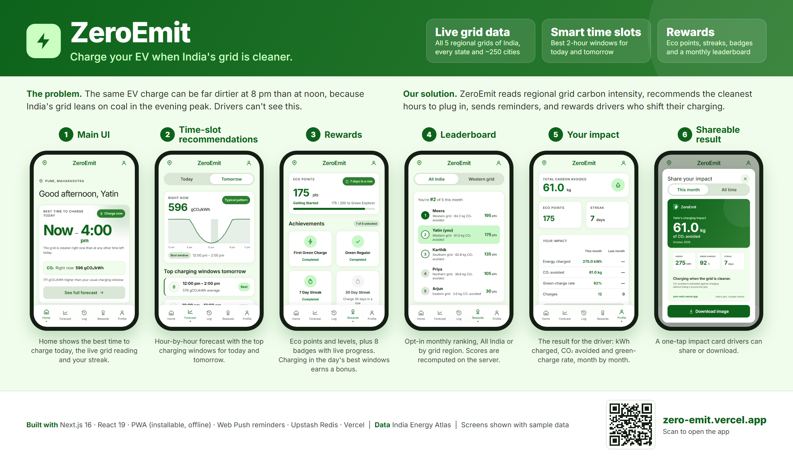

# ZeroEmit

ZeroEmit is a mobile-first Next.js PWA that helps EV drivers in India charge when the grid is cleaner: it recommends the cleanest charging windows from live regional grid data, rewards charging at those times, and shows the impact.

Live at [zero-emit.vercel.app](https://zero-emit.vercel.app).



Poster downloads: landscape ([PNG](docs/poster/ZeroEmit-poster-landscape.png), [PDF](docs/poster/ZeroEmit-poster-landscape.pdf)) · portrait ([PNG](docs/poster/ZeroEmit-poster-portrait.png), [PDF](docs/poster/ZeroEmit-poster-portrait.pdf)). Both include a QR code to the live app. The editable HTML source and app screenshots are in [`docs/poster/source`](docs/poster/source); screens use sample data.

## Features

- **Best time to charge.** Home shows today's cleanest 2-hour window for your region; Forecast shows the hour-by-hour curve and the top 3 windows for today and tomorrow. **Add to calendar** saves a window as a calendar event with a reminder 10 minutes before it starts (works on every phone, no notifications needed).
- **Locations across India.** ~250 searchable cities in every mainland state/UT, each mapped to one of India's five regional grids, or "Use current location" (resolved to the nearest city on the device).
- **Log charges.** Each charge records the grid intensity and how well it was timed. Charges can be logged up to 30 days back, and a deleted charge can be restored with **Undo**. Charge details show an estimated cost from your electricity price (Profile & vehicle; ₹8/kWh, a typical home tariff, until you set yours).
- **Eco points and rewards.** 10 points per charge, **+10** in one of the day's 3 cleanest 2-hour windows for your region, **+5** at a cleaner-than-average hour. Four levels, 8 badges with live progress, and streaks. (India's grid rarely reaches an absolute "green" level, so points reward timing relative to your region.)
- **Monthly leaderboard (opt-in).** All India or by grid region, resetting on the 1st. Only a display name, region and this month's points and CO₂ avoided are shared. The server recomputes every score from the charges themselves, judging each charge's timing from its own grid data, so a bonus can't be faked, and caps the CO₂ a charge can claim to what its region's grid can plausibly reach. Each display name can be used by one entry a month (ignoring case and spacing), and members show up once they've logged a charge that month.
- **Your impact.** This month vs last month: energy, CO₂ avoided, green-charge rate, charges and cost, with everyday comparisons ("like not driving 113 km in a petrol car"), and a shareable impact card (this month, last month or all time).
- **Nearest chargers, on a map.** Public EV chargers within 30 km, nearest first, with connector types, 24/7 status and Google Maps directions, plus an OpenStreetMap map (Leaflet). They're searched around **your own location** if you tap "Use my location" (rounded to ~1 km on the device before it's sent), otherwise around your city's centre. Grid data and points still use your city's regional grid.
- **Notifications** (see below), **dark mode**, an **install prompt** (Android/Chrome install button; iPhone "Add to Home Screen" steps), and a three-screen welcome intro.

## Data sources

- **Grid carbon intensity:** [India Energy Atlas](https://api.energymap.in) zone-level data for the five regional grids. The server ignores the provider's still-filling current hour, which reads far too low.
- **Charging stations and map:** [OpenStreetMap](https://www.openstreetmap.org/copyright) data. Asking the public Overpass API on each visit took up to 20 s from India (or got rate-limited), so a snapshot of every charger in India (about 600, 66 KB) ships in `src/app/lib/server/chargers-india.json` and `/api/stations` picks the nearest from it in milliseconds. Map tiles are OpenStreetMap's standard tiles. Coverage is good in big cities and patchy elsewhere.
- **Impact comparisons:** about 150 g CO₂/km for a petrol car and 21 kg CO₂ absorbed per mature tree per year; the app shows these assumptions next to the numbers.

## Run locally

```bash
bun install
cp .env.example .env.local
bun dev
```

Add `INDIA_ENERGY_ATLAS_API_KEY` to `.env.local` for live grid data. The key is used only by the server route at `/api/grid`; it is never sent to the browser.

- **Current intensity** works on the free Sandbox tier via zone-level data for all five regional grids (Northern, Western, Southern, Eastern, North-Eastern), falling back to the all-India aggregate if a zone lookup fails.
- **24-hour forecasts** require the Pro plan or above. On the free tier, the app builds a "typical day" pattern per zone from up to 14 days of real hourly readings (averaged by hour of day in IST) and labels it "Typical pattern" in the UI. It falls back further to your own charging history if even that isn't available yet.
- `ELECTRICITY_MAPS_API_KEY` is an optional, lower-precision regional fallback (its free tier is limited to one zone per account).

Without a configured provider, the app shows "Live data unavailable" instead of fabricated values.

## Tests

```bash
bun test                      # unit tests (scoring, leaderboard, scheduler, calendar, chargers, ...)
bunx tsc --noEmit             # type check (test files are excluded from tsconfig)
bun run lint
```

## Notifications

Each kind is switchable in Profile → Notifications, and tapping one opens the relevant page. On iPhone, notifications require adding the app to the Home Screen (iOS 16.4+).

- **On the device:** charge confirmations and rewards (levels, achievements, streak milestones), plus in-app toasts.
- **Scheduled, from the server (Web Push), even when the app is closed:**
  - **Best time to charge:** a reminder as today's cleanest window approaches, and at 9 pm for tonight's, each with a **Log a charge** button where the platform supports it (Android/desktop).
  - **Morning digest** and an evening **streak reminder**.
  - **Leaderboard updates** (once you've joined): someone passed you, reaching #1, and your final rank on the 1st (which opens a Last month share card).
  - **Progress and weekly recap:** a nudge when a badge is nearly unlocked, and a Sunday-evening summary of your week.
  - Nothing is sent 10 pm – 7 am IST. Without push configured, "best time" falls back to an in-app check while the app is open.

### Setting up scheduled notifications and the leaderboard

1. **Redis:** in Vercel → the project → Storage (Marketplace) → add **Upstash Redis** and connect it to the project. This sets `KV_REST_API_URL` / `KV_REST_API_TOKEN`. The leaderboard and push scheduler both use it.
2. **Environment variables** in Vercel (Production), copied from your local `.env.local` (generate keys with `npx web-push generate-vapid-keys` if you don't have them):
   `NEXT_PUBLIC_VAPID_PUBLIC_KEY`, `VAPID_PRIVATE_KEY`, `VAPID_SUBJECT` (your site URL), `CRON_SECRET` (any long random string).
3. **Scheduler:** Vercel's Hobby plan only allows a once-a-day cron (`vercel.json`, a backup for the morning digest), so `.github/workflows/push-schedule.yml` calls `/api/push/run` every 15 minutes. Add a repository secret `CRON_SECRET` with the same value (and optionally a repository variable `SITE_URL`).
4. **Redeploy** (the public key is baked in at build time), open the app, turn on notifications, and use **Send a test notification**: with push active it goes through the server, the same path as reminders.

The scheduler refreshes grid data at most hourly per region and not at all overnight, and reads the leaderboard once per run. To stay well inside the trial key's 100 calls/day, the app as a whole stops calling India Energy Atlas after 90 calls in an IST day (counted in Redis) and serves the last good data until the next day. GitHub pauses scheduled workflows in public repos after 60 days without commits; re-enable it from the Actions tab if that happens.

### Leaderboard moderation

Only the device that joined can update or remove its entry. To remove an entry whose device can no longer leave, or an offensive name:

```bash
curl -X POST https://zero-emit.vercel.app/api/leaderboard/admin \
  -H "Authorization: Bearer $CRON_SECRET" -H "Content-Type: application/json" \
  -d '{"name":"Display Name","zone":"southern"}'
```

Add `"maxPoints":0` to remove only that name's entries with at most that many points this month, e.g. a leftover duplicate from another device that never logged a charge. Removing an entry frees its name.

## Refreshing the charger snapshot

The **Refresh charger snapshot** GitHub workflow runs `bun run chargers` every Monday and commits the snapshot if it changed, which redeploys the app. The script asks several Overpass servers at once and keeps the current snapshot if none answers, or if the new one has 20% fewer chargers (a likely partial answer). When the servers are busy, save the answer to the query in `INDIA_CHARGERS_QUERY` (`src/app/lib/stations.ts`) another way, e.g. on overpass-turbo.eu, and run `bun run chargers path/to/answer.json`.

## Regenerating PWA icons

`public/icons/zeroemit.svg` and `zeroemit-maskable.svg` are the source icons. Running `bun run icons` rasterizes them (via `sharp`) into the PNGs referenced by `app/manifest.ts` and `app/layout.tsx` (`icon-192.png`, `icon-512.png`, `icon-maskable-512.png`, `apple-touch-icon-180.png`). Re-run this after editing either source SVG and commit the resulting PNGs.

## Production

```bash
bun run lint
bunx tsc --noEmit
bun run build
bun start
```

Deploy behind HTTPS so the service worker, push and install prompt work. Charges, profile and settings stay on the device; there are no accounts, so the leaderboard identifies each device by a random ID and key, and joining on another device creates a separate entry.
