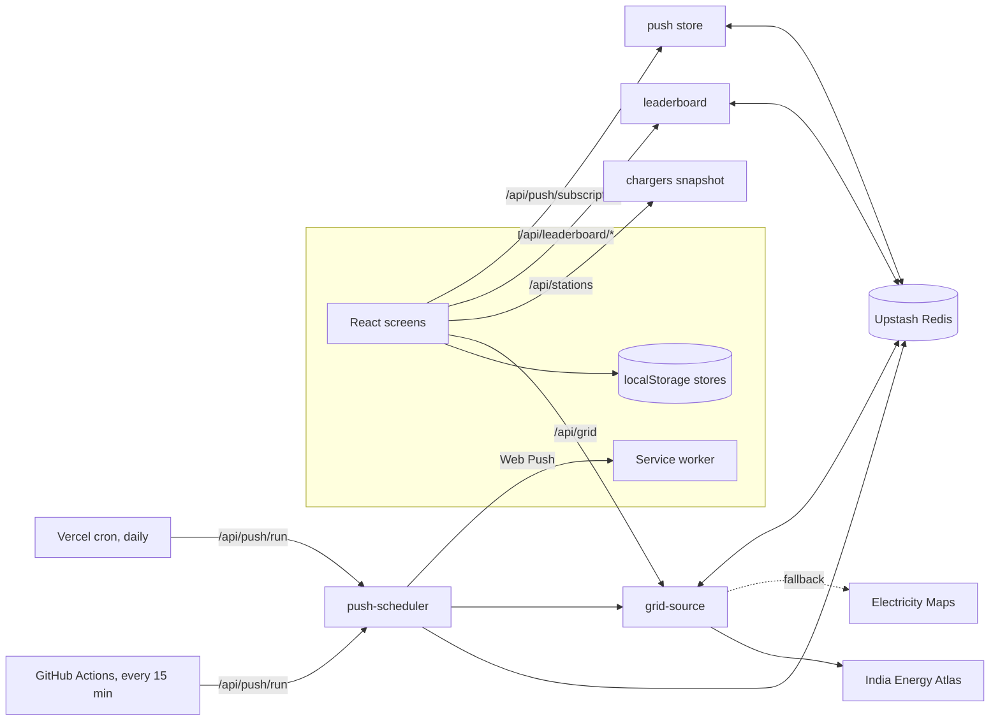

# ZeroEmit

A mobile-first Next.js PWA that tells EV drivers in India when their regional grid is cleanest, plans a charge around it, scores charges by how well they were timed, runs an opt-in monthly leaderboard (public, and private groups joined with a code), tells each month's story in a shareable recap, and sends scheduled Web Push reminders.

Live at [zero-emit.vercel.app](https://zero-emit.vercel.app). The exhibition poster (PNG/PDF, with editable HTML source) is in [`docs/poster`](docs/poster).

## Stack

| Layer | Choice |
| --- | --- |
| Framework | Next.js 16 (App Router, Route Handlers), React 19 with React Compiler |
| Language / runtime | TypeScript 5, Bun 1.3 (package manager, scripts, test runner) |
| Styling | Tailwind CSS 4 (PostCSS) plus hand-written tokens in `src/app/globals.css`, light/dark via `prefers-color-scheme` or `data-theme` |
| Motion | GSAP 3 (`@gsap/react`), Lenis smooth scroll; everything is skipped under `prefers-reduced-motion` |
| Maps | Leaflet 1.9 with OpenStreetMap tiles |
| Server state | Upstash Redis over its REST API (`src/app/lib/server/redis.ts`), no ORM |
| Push | `web-push` (VAPID) |
| Hosting | Vercel; GitHub Actions for the 15-minute scheduler and the weekly charger refresh |

> This Next.js version has breaking changes from older releases. Read the guide in `node_modules/next/dist/docs/` before changing framework-level code (see `AGENTS.md`).

## Architecture



There are no accounts. Profile, charges, location and settings live in `localStorage`; the server only sees what a feature needs (a state for grid data, a city or rounded position for chargers, and opt-in leaderboard/push records). The leaderboard identifies a device by a random UUID `id` plus a secret `key`, stored server-side only as a hash.

## Repository layout

```
src/app/
  page.tsx, forecast/, log/, stations/, rewards/, rewards/leaderboard/, profile/   routes (thin; render a *-screen component)
  layout.tsx            fonts, theme boot script, global client mounts (LocationGate, PushSync, LeaderboardSync, ThemeSync, ToastHost, ...)
  manifest.ts           PWA manifest
  api/                  Route Handlers (see API)
  components/           client components, hooks and localStorage stores
  lib/                  pure logic shared by client and server (grid, timing, rewards, leaderboard scoring, places, stations, cost, calendar)
  lib/server/           server-only code: grid-source, leaderboard, push, push-scheduler, overpass, redis, http helpers
  lib/server/chargers-india.json   bundled OpenStreetMap charger snapshot
public/sw.js            service worker (caching, push, notification clicks)
public/icons/           source SVG icons and generated PNGs
scripts/fetch-chargers.ts   rebuilds the charger snapshot from Overpass
.github/workflows/      push-schedule.yml (every 15 min), chargers-refresh.yml (weekly)
docs/poster/            exhibition poster and its HTML source
pics/                   original design mockups
```

Tests sit next to the code as `*.test.ts` and run under `bun test`. `tsconfig.json` excludes them from the type check.

## Client

### Routes

| Path | Screen | Notes |
| --- | --- | --- |
| `/` | Dashboard | Today's best 2-hour window, live intensity, metrics, streak, tomorrow's best, nearest chargers; in a month's first week, a link to last month's recap |
| `/forecast` | Forecast | Hourly chart and top windows for today/tomorrow (`?day=tomorrow`); tap a window to add it to the calendar |
| `/forecast/plan` | Charge planner | Energy to add, charger speed and a ready-by time give the cleanest start; add it to the calendar (see [Charge planner](#charge-planner-libplannerts)) |
| `/log` | Charge log | History, add/delete with undo; `?quick=1` opens the form (used by notification actions) |
| `/stations` | Chargers | Leaflet map and up to 20 nearest chargers within 30 km |
| `/rewards` | Rewards | Points, levels, badges, how to earn |
| `/rewards/leaderboard` | Leaderboard | Join/rename/leave, all-India or per-zone board |
| `/rewards/groups` | Groups | `?code=` a group's board with its invite code, share and leave; `?join=` (an invite link) also opens the join sheet; no query lists the device's groups |
| `/profile` | Profile | Name/vehicle/price, impact table, monthly recap link, share card (`?share=last-month`), settings, delete data |
| `/recap` | Recap | Full-screen story of a month (`?period=2026-10`) or a year (`?period=2026`), ending with a 9:16 share image (see [Recap](#recap-librecapts)) |

### Local state

Every persisted value goes through `createLocalStorageStore` (`components/local-storage-store.ts`), a `useSyncExternalStore` adapter that:

- caches the parsed value against the raw string, so snapshots stay referentially stable;
- returns a fixed server snapshot, so prerendered HTML never depends on storage;
- wraps every storage call in `try/catch`, and keeps a write in memory for the visit when storage refuses it (private mode, blocked storage, quota).

Main keys, all prefixed `zeroemit-`:

| Key | Holds |
| --- | --- |
| `charges` | Charge records: `energyKwh`, `chargedAt`, `city`, `carbonIntensity`, `intensitySource`, `timing` (`best`/`cleaner`/`other`), `baselineIntensity`, `loggedAt` |
| `profile` | `name`, `vehicle`, `pricePerKwh`, `joinedAt` |
| `location` | Chosen `{ name, state }`; `null` means first launch |
| `notification-prefs` | Per-kind switches |
| `theme` | `system`/`light`/`dark` |
| `leaderboard`, `leaderboard-pending-join`, `leaderboard-pending-leave`, `leaderboard-synced` | Membership (`id`, `key`, name, zone) and retry queues |
| `planner` | The planner's last `kwh` (null means "use my usual charge"), `charger` and `readyBy` (`HH:MM`) |
| `intro-seen`, `install-dismissed`, `chargers-near-me`, `push-active`, `clean-alert` | UI flags |

### First load and hydration

- `lib/theme-boot.ts` runs inline in `<head>` before first paint. It applies a pinned theme, and on first launch (no saved location) sets `data-first-run` on `<html>`, which hides `.mobile-app` until the welcome flow covers it.
- `LocationGate` (mounted in the layout) shows the three-slide intro and the "Where do you charge?" picker over any route until a place is chosen, and marks everything behind it `inert`.
- `useLocationPicker().ready` is false until hydration *and* a saved place exist. Screens use it to hold off on showing a place name or fetching data for the default city.

### Grid data on the client

`useGridData(state)` fetches `/api/grid`. It refetches every 15 minutes while the page is visible and on return if the last fetch is at least 5 minutes old. A failed refresh keeps the last good data for the same state and surfaces the error. `lib/grid.ts` only treats `current` as "now" when the reading is under 3 hours old (Atlas's newest complete hour trails the clock).

### Service worker (`public/sw.js`)

- `zeroemit-v3`: app shell, network-first for navigations (falls back to the cached page after a timeout or offline).
- `zeroemit-static-v1`: `/_next/static` assets, cache-first, trimmed to the newest 150 entries.
- `/api/*` is never cached.
- Handles `push` and `notificationclick`; a click focuses an open window or opens the notification's URL, including the "Log a charge" action.

`sw.js` itself is served with `no-store` and a strict CSP (`next.config.ts`). All responses get `nosniff`, `X-Frame-Options: DENY` and a strict referrer policy.

## Charge planner (`lib/planner.ts`)

The planner answers "I need this much charge by this time: when should I plug in?". It runs on the device from the same `/api/grid` answer as the forecast, so it costs no extra requests.

- **Inputs.** Energy to add (0.5–150 kWh; defaults to the average charge in the chosen city, else 10 kWh), a charger (scooter 0.75 kW, home socket 3.3 kW, wallbox 7.2 kW, DC fast 30 kW) and a ready-by clock time. The deadline is the next time the clock reads that time in IST.
- **Duration.** `kWh ÷ kW`, rounded up to 5 minutes. It assumes the charger's full speed; the page says to leave spare time because cars slow down near 100%.
- **Curve.** The forecast with the live reading merged in as "now" (`mergeLiveReading`). Each point covers its whole hour, and a charge's average is weighted by the minutes it spends in each hour (`averageBetween`).
- **Search.** On an hourly step curve, a fixed-length stretch averages lowest with its start or its end on an hour boundary, or at a limit (now, or the latest start that still finishes by the deadline). `planCharge` compares only those starts. Ties go to the earlier start. Waiting must pay: a later start has to beat plugging in now by at least 10 gCO₂/kWh and 3%, or the plan is "now".
- **Night starts.** A start from 10 pm to 6 am says to plug in before bed and set a timer, and its calendar reminder comes at 9:30 pm the evening before (`bedtimeBefore`) instead of waking the driver.
- **Results.** `plan` (start, end, average, the average if plugged in now, grams saved, % cleaner), `short` (not enough time; how many kWh plugging in now adds by the deadline), `beyond` (the deadline is past the end of the forecast) or `no-data`.
- **Extras.** The plan shows the timing bonus its start would earn when logged (same `chargeTiming` as the log form; none under 2 kWh), a chart band for the charge, and an Add to calendar event with a 10-minute alarm (`chargingWindowIcs` with `kind: "plan"`, so its UID never clashes with a window's).

## Recap (`lib/recap.ts`)

A story of one month (or year) of charging, built on the device from its own history, so it needs no server.

- **Periods.** IST months with a charge, newest first, plus each year with charges in more than one month. With no `?period=`, the page opens last month during the first week of a month, else this month, else the latest month.
- **Pages.** Cover; charges, kWh and cost at the driver's price; timing split (best window / cleaner hour / other) against the month before; CO₂ avoided with everyday equivalents; the cleanest charge; the usual plug-in time and busiest weekday; Eco points, longest streak, level, and badges first unlocked in the period (achievements up to the period's end minus those before it). Pages with nothing to say are left out.
- **Navigation.** Tap the right two-thirds to go on and the left third to go back, swipe, or use the arrow keys; Escape closes. Buttons at the bottom do the same for keyboards and screen readers, and each page is announced politely. Animations are skipped under `prefers-reduced-motion`.
- **Sharing.** The last page draws a 1080 × 1920 story card on a canvas (`components/recap-card.ts`) as soon as it shows, so Share can call `navigator.share` straight from the tap; Save image downloads it.
- **Ways in.** Profile → Your impact, a Home banner in each month's first week, and the month-end leaderboard notification, which now opens last month's recap.

## Scoring (`lib/rewards.ts`, `lib/timing.ts`)

| Rule | Value |
| --- | --- |
| Points per charge | 10 |
| Timing bonus | +10 if the charge starts in one of the day's 3 cleanest 2-hour windows for its zone (23:00 windows wrap past midnight); +5 at a cleaner-than-average hour |
| Minimum energy for points | 2 kWh (`MIN_POINTS_KWH`); smaller charges still count for energy totals and streaks |
| Maximum energy per charge | 150 kWh |
| CO₂ avoided | `max(0, baseline - intensity) × kWh`; baseline is the day's average intensity for the zone (`baselineIntensity`), or 650 g/kWh for older charges without it |
| Streak badges | Unlock from the longest streak ever (IST days), so a broken streak doesn't re-lock them |

All day/week/month boundaries use IST (`istDayKey`, `istMonthKey`).

## Server

### API

| Method & path | Auth | Purpose | Caching / limits |
| --- | --- | --- | --- |
| `GET /api/grid?state=` | none | Current intensity, 24-hour forecast or typical pattern for the state's zone | `s-maxage=300, swr=600`; 400 for an unknown state |
| `GET /api/stations?state=&city=` or `&lat=&lon=` | none | Up to 20 chargers within 30 km; `farther` holds the nearest 3 when none are in range | `s-maxage=86400` |
| `GET /api/leaderboard?scope=all\|<zone>&me=` | none | Top 50 for the month, plus the caller's standing when `me` is given | `s-maxage=10, swr=30` without `me`, `no-store` with it |
| `POST /api/leaderboard/member` | same-origin + `id`/`key` | Join, sync score or rename | 20 new members per IP per hour, 30 updates per member per hour; 409 `name-taken` |
| `DELETE /api/leaderboard/member` | same-origin + `id`/`key` | Leave | |
| `GET /api/leaderboard/groups?code=[&me=]` | none | A group's board this month, plus `group: { code, name, members }`; 404 `no-group` | `s-maxage=10, swr=30` without `me`, `no-store` with it |
| `GET /api/leaderboard/groups?member=` | none | The groups a member is in, with size and their rank | `no-store` |
| `POST /api/leaderboard/groups` | same-origin + `id`/`key` | `action: "create"` (with `name`), `"join"` or `"leave"` (with `code`) | 3 creates and 20 joins per member per hour; 404 `not-member`/`no-group`, 409 `too-many`/`full` |
| `POST /api/leaderboard/admin` | `Bearer CRON_SECRET` | Remove an entry by name and zone (moderation) | |
| `POST /api/push/subscription` | same-origin | Save or update a push subscription with its prefs and summary | 20 new per IP per hour, 60 updates per device per hour, cap 2000 (503 `full`) |
| `DELETE /api/push/subscription` | same-origin | Remove a subscription | |
| `POST /api/push/test` | same-origin | Send a test push through the real path | 429 within a few seconds of the last test |
| `GET`/`POST /api/push/run` | `Bearer CRON_SECRET` | Run the scheduler | `maxDuration = 60` |

"Same-origin" is `fromOwnSite()` in `lib/server/http.ts`: JSON content type, and `Sec-Fetch-Site`/`Origin` must match the site. Request bodies are read as a stream through `readLimitedJson()`, which stops at the size limit. Cron calls compare the secret in constant time.

### Grid data (`lib/server/grid-source.ts`)

1. India Energy Atlas zone-level data for the five regional grids (Northern, Western, Southern, Eastern, North-Eastern), with the all-India aggregate as a fallback. The provider's still-filling current hour is ignored because it reads far too low.
2. Without a forecast entitlement (Pro plan), a typical day is built per zone from up to 14 days (336 hours) of hourly readings, averaged by IST hour, and labelled "Typical pattern".
3. `ELECTRICITY_MAPS_API_KEY` is an optional, coarser fallback.
4. Without any provider the API returns `available: false` and the UI shows "unavailable"; nothing is made up.

Zone snapshots are cached in memory (60 s) and in Redis (`zone:<zone>`, 24 h TTL) and refreshed upstream at most hourly. `atlas:lock:<zone>` (30 s) stops parallel refreshes. `atlas:calls:<IST day>` stops all upstream calls after 90 per day (`ATLAS_DAILY_BUDGET`), to stay inside the trial key's 100/day.

### Leaderboard (`lib/server/leaderboard.ts`, `lib/leaderboard.ts`)

- The server re-scores every submission from the charges themselves (`scoreMonth`). It judges timing against its own grid pattern, counts at most 2 charges a day and 100 a month, and caps intensities at 2000 g/kWh. A client can't fake a bonus.
- Display names are 1–20 characters and unique per month, ignoring case and spacing (`lb:<month>:names`, `HSETNX`). Names taken by others get a suggestion like "Asha 2".
- Members with 0 points are left out of ranks, totals and leaderboard pushes.
- Member records expire after 70 days without a sync. A sync that gets 404/409 clears local membership and tells the user they can rejoin.

### Groups (`lib/server/groups.ts`, `lib/groups.ts`)

Private monthly boards for a class, an office or a housing society.

- A group is a name (2–30 characters, same rules as display names) and a 6-character code from an alphabet without 0/O or 1/I, shown as `ABC-234`. Codes are claimed with `SET NX`, so two groups never share one.
- Only leaderboard members can create or join one, so a group ranks the same server-scored Eco points. Someone who isn't on the leaderboard yet picks a display name in the same sheet and joins both at once; the sheet says they'll appear on the public board too.
- Each member sync (`submitMember`) writes the member's score to every group board they're in, in the same transaction as the public boards, and refreshes the group's expiry. A group closes 120 days after its last sync or join.
- Limits: 50 members a group, 5 groups a member, 3 new groups and 20 join attempts per member per hour (a billion codes can't be guessed at that rate).
- Leaving the leaderboard, Delete my data, and admin removal also take the entry off every group. Expired groups drop off a member's list the next time it's read.
- Invites share `/rewards/groups?join=<code>` through the share sheet, or copy it where there is none.

### Push scheduler (`lib/server/push-scheduler.ts`, `lib/server/push.ts`)

GitHub Actions calls `/api/push/run` every 15 minutes from 06:30 to 22:15 IST; a Vercel cron at 08:00 IST is a daily backup (the Hobby plan allows only one). Each run:

- refreshes at most 2 zones from upstream, and only when their data is over an hour old;
- plans each subscriber's notifications:
  - "best time" reminders, about 35 minutes before a clean window and at 9 pm for tonight's;
  - the morning digest;
  - streak reminders, which open `/log?quick=1` with a "Log a charge" action;
  - leaderboard changes (the month-end result opens last month's recap);
  - badge nudges and the Sunday recap;
- records sent "marks" per day or month in `push:state`, so nothing repeats;
- sends with a concurrency of 20, never from 22:00 to 07:00 IST;
- removes subscriptions that weren't refreshed for 90 days, and any the push service reports as gone.

### Chargers (`lib/stations.ts`, `scripts/fetch-chargers.ts`)

The public Overpass API was too slow from India (up to 20 s, or rate-limited), so `/api/stations` reads a bundled snapshot of every `amenity=charging_station` in India (about 600). Operator names are normalised when the snapshot is read ("tata power" becomes "Tata Power"). Chargers with no name show as "Unnamed EV charger", with distance and compass direction. On phones the map turns off one-finger dragging so the page still scrolls.

### Redis keys

| Key | Type | Use |
| --- | --- | --- |
| `zone:<zone>` | string (JSON) | Grid snapshot per zone |
| `atlas:calls:<day>`, `atlas:lock:<zone>` | counter, lock | Upstream budget and single-flight refresh |
| `lb:<month>:<scope>` | sorted set | Monthly board per scope (`all` or a zone) |
| `lb:<month>:names` | hash | Name uniqueness for the month |
| `lb:member:<id>` | string (JSON) | Member record: SHA-256 of the key, name, zone, month, points, CO₂ |
| `lb:removed:<id>` | string | 24 h marker set on leave, so a sync already in flight can't recreate the entry |
| `lb:group:<code>` | string (JSON) | Group: name, created time, creator id (120 days after the last activity) |
| `lb:group:<code>:members` | hash | Member id to join time |
| `lb:<month>:g:<code>` | sorted set | The group's board that month |
| `lb:mgroups:<id>` | hash | The groups a member is in (code to join time) |
| `lb:gnew:<id>`, `lb:gjoin:<id>` | counters | Group create and join rate limits |
| `lb:new:<ip>`, `lb:rate:<id>` | counters | Leaderboard rate limits |
| `push:subs` | hash | Subscriptions, prefs and summaries, keyed by an endpoint hash |
| `push:state` | hash | Scheduler marks, so pushes aren't repeated |
| `push:new:<ip>`, `push:rate:<id>` | counters | Subscription rate limits |

## Environment variables

| Variable | Needed for | Notes |
| --- | --- | --- |
| `INDIA_ENERGY_ATLAS_API_KEY` | Live grid data | Server-only. The free tier gives zone-level current data; forecasts need Pro |
| `INDIA_ENERGY_ATLAS_FORECAST` | Optional | Set to `1` to call the forecast endpoint (needs the Pro plan; the trial key is always refused) |
| `ELECTRICITY_MAPS_API_KEY` | Optional fallback | Free tier covers one zone |
| `KV_REST_API_URL`, `KV_REST_API_TOKEN` | Leaderboard, push, grid cache | Set by Vercel's Upstash integration (`UPSTASH_REDIS_REST_URL`/`_TOKEN` also work) |
| `NEXT_PUBLIC_VAPID_PUBLIC_KEY`, `VAPID_PRIVATE_KEY`, `VAPID_SUBJECT` | Scheduled push | Generate with `npx web-push generate-vapid-keys`; the public key is inlined at build time |
| `CRON_SECRET` | `/api/push/run`, admin route | Same value in Vercel and as a GitHub Actions secret |

Copy `.env.example` to `.env.local` for local development. Without Redis, the leaderboard and scheduled push return 503 and their UI hides itself. Without VAPID keys, "best time" alerts fall back to an in-app check while the app is open.

## Development

```bash
bun install
cp .env.example .env.local
bun dev                 # http://localhost:3000
```

| Command | Does |
| --- | --- |
| `bun test` | Unit tests (scoring, timing, grid, leaderboard, scheduler, push, http, stations, places, calendar, ...). The "boom" stack trace in the output comes from `pool.test.ts` on purpose |
| `bunx tsc --noEmit` | Type check |
| `bun run lint` | ESLint (`eslint-config-next`; `*.cjs` scripts may use `require`) |
| `bun run build` / `bun start` | Production build and server |
| `bun run chargers [answer.json]` | Rebuild the charger snapshot from Overpass, or from a saved Overpass answer |
| `bun run icons` | Rasterise `public/icons/*.svg` into the manifest and Apple touch PNGs (uses `sharp`) |

Before pushing, run `bun test`, `bunx tsc --noEmit`, `bun run lint` and `bun run build`.

## Deployment

1. Deploy to Vercel over HTTPS (needed for the service worker, push and install prompt).
2. Add Upstash Redis from Vercel → Storage and connect it to the project.
3. Set the VAPID variables and `CRON_SECRET` for Production, then redeploy so the public key is built in.
4. In GitHub, add the repository secret `CRON_SECRET` and optionally the variable `SITE_URL` (defaults to the production URL).
5. Open the app, turn on notifications, and use **Send a test notification**.

## Operations

- **Charger snapshot:** `chargers-refresh.yml` runs `bun scripts/fetch-chargers.ts` every Monday at 03:00 IST and commits the snapshot if it changed, which redeploys the app. The script queries several Overpass servers at once, and keeps the old snapshot if none answers or if the new one has 20% fewer chargers. When the servers are busy, run the query in `INDIA_CHARGERS_QUERY` (`src/app/lib/stations.ts`) on overpass-turbo.eu and pass the saved answer to `bun run chargers`.
- **Moderation:** remove a leaderboard entry by name. Add `"maxPoints": 0` to remove only that name's entries with at most that many points, such as a leftover duplicate.

  ```bash
  curl -X POST https://zero-emit.vercel.app/api/leaderboard/admin \
    -H "Authorization: Bearer $CRON_SECRET" -H "Content-Type: application/json" \
    -d '{"name":"Display Name","zone":"southern"}'
  ```

- **Scheduled workflows:** GitHub disables scheduled workflows in public repos after 60 days without commits. If that happens, every push except the 08:00 IST Vercel cron stops. Re-enable it from the Actions tab.
- **Data sources and attribution:** grid data from [India Energy Atlas](https://api.energymap.in); chargers and map tiles © [OpenStreetMap contributors](https://www.openstreetmap.org/copyright) (ODbL). The credit appears wherever charger data is shown. Impact comparisons assume about 150 g CO₂/km for a petrol car and 21 kg CO₂ per mature tree per year.
