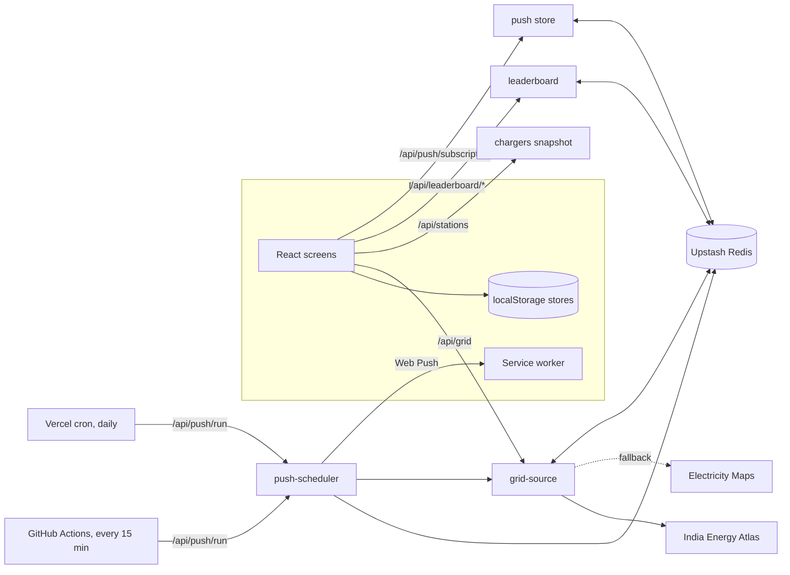

# ZeroEmit

A mobile-first Next.js PWA that tells EV drivers in India when their regional grid is cleanest, plans a charge around it, scores charges by how well they were timed, runs an opt-in monthly leaderboard (public, and invite-only groups joined with a code), tells each month's story in a shareable recap, and sends scheduled Web Push reminders.

Live at [zero-emit.vercel.app](https://zero-emit.vercel.app). The exhibition poster (PNG/PDF, with editable HTML source) is in [`docs/poster`](docs/poster).

## Stack

| Layer | Choice |
| --- | --- |
| Framework | Next.js 16 (App Router, Route Handlers), React 19 with React Compiler |
| Language / runtime | TypeScript 5, Bun 1.3 (package manager, scripts, test runner) |
| Styling | Tailwind CSS 4 (PostCSS) plus hand-written tokens in `src/app/globals.css`, light/dark via `prefers-color-scheme` or `data-theme` |
| Motion | GSAP 3 (`@gsap/react`), Lenis smooth scroll; everything is skipped under `prefers-reduced-motion` |
| Maps | Leaflet 1.9 with OpenStreetMap tiles |
| Server state | Upstash Redis over its REST API (`src/app/lib/server/redis.ts`), no ORM; each call times out after 8 s and fails like any other Redis error |
| Push | `web-push` (VAPID) |
| Hosting | Vercel; GitHub Actions for the 15-minute scheduler and the weekly charger refresh |

> This Next.js version has breaking changes from older releases. Read the guide in `node_modules/next/dist/docs/` before changing framework-level code (see `AGENTS.md`).

## Architecture



There are no accounts. Profile, charges, location and settings live in `localStorage`; the server only sees what a feature needs (a state for grid data, a city or rounded position for chargers, and opt-in leaderboard/push records). The leaderboard identifies a device by a random UUID `id` plus a secret `key`, stored server-side only as a hash.

## Repository layout

```
src/app/
  page.tsx, forecast/, log/, stations/, rewards/, rewards/leaderboard/, profile/   routes (thin; render a *-screen component)
  layout.tsx            fonts, theme boot script, global client mounts (LocationGate, PushSync, LeaderboardSync, ThemeSync, ToastHost, ...)
  manifest.ts           PWA manifest
  api/                  Route Handlers (see API)
  components/           client components, hooks and localStorage stores
  lib/                  pure logic shared by client and server (grid, timing, rewards, leaderboard scoring, places, stations, cost, calendar)
  lib/server/           server-only code: grid-source, leaderboard, push, push-scheduler, overpass, redis, http helpers
  lib/server/chargers-india.json   bundled OpenStreetMap charger snapshot
public/sw.js            service worker (caching, push, notification clicks)
public/icons/           source SVG icons and generated PNGs
scripts/fetch-chargers.ts   rebuilds the charger snapshot from Overpass
.github/workflows/      push-schedule.yml (every 15 min), chargers-refresh.yml (weekly)
docs/poster/            exhibition poster and its HTML source
pics/                   original design mockups
```

Tests sit next to the code as `*.test.ts` and run under `bun test`. `tsconfig.json` excludes them from the type check.

## Client

### Routes

| Path | Screen | Notes |
| --- | --- | --- |
| `/` | Dashboard | Four blocks: the next clean 2-hour window in the coming 24 hours (with Plan a charge and Forecast), one strip of Eco points / CO₂ avoided / streak, Log a charge, and the nearest chargers; in a month's first week, a link to last month's recap. The grid data's age shows here only when an update failed |
| `/forecast` | Forecast | Hourly chart and top windows for the next 24 hours (default), today (`?day=today`) or tomorrow (`?day=tomorrow`); tap a window to add it to the calendar |
| `/forecast/plan` | Charge planner | Energy to add, charger speed and a ready-by time give the cleanest start; add it to the calendar (see [Charge planner](#charge-planner-libplannerts)) |
| `/log` | Charge log | History in month sections with each month's totals, each charge's chip coloured by its timing (best window, cleaner hour, other); add/delete with undo; charges logged as kWh or, once Profile knows the EV, as battery % (see [Vehicles](#vehicles-libvehiclests)); `?quick=1` opens the form (used by notification actions) |
| `/stations` | Chargers | A tab of its own: Leaflet map and up to 20 nearest chargers within 30 km, filtered by network (operator) or, where listed, connector |
| `/rewards` | Rewards | Points, levels, badges, how to earn |
| `/rewards/leaderboard` | Leaderboard | Join/rename/leave, all-India or per-zone board |
| `/rewards/groups` | Groups | `?code=` a group's board with its invite code, share and leave; `?join=` (an invite link) also opens the join sheet; no query lists the device's groups |
| `/profile` | Profile (the avatar in the top bar) | Name/EV/price, impact table, links to the monthly and all-time recaps (`?share=last-month` from old notifications redirects to last month's recap), settings, back up and restore, delete data |
| `/recap` | Recap | Full-screen story of a month (`?period=2026-10`) or a year (`?period=2026`), ending with a 9:16 share image (see [Recap](#recap-librecapts)) |

### Navigation and look

- The tab bar is Home, Forecast, Log, Chargers and Rewards; Profile is the top bar's avatar (the driver's initials once they've given a name). On desktop the tabs become a sidebar.
- On phones the tab bar floats as frosted glass: a mostly opaque background (82% white, 86% dark green, so its 11px labels stay readable over buttons scrolling underneath) with `backdrop-filter: blur(22px) saturate(180%)`, a hairline border and an inner highlight, in light and dark. Browsers without `backdrop-filter` get the solid bar.
- On phones the tab bar is mounted once in the root layout (`TabBar` in `components/app-shell.tsx`), so it stays put while pages change under it; desktop uses each page's sidebar (`BottomNav`). A glass pill sits behind the current tab and slides between tabs with a little spring (`.nav-pill`). Pressing a tab sends the pill there at once and lifts it slightly; dragging along the bar carries the pill under the finger (a light vibration at each tab on Android), and letting go opens the tab it's over. Once the page changes (Back included) the pill goes back to following the current tab. With reduced motion the pill moves without sliding. A new screen appears at once, like a native tab switch (no fade-in, which left the screen blank for a moment on slower phones).
- Production polish: the forecast chart is drawn at its real width (labels and lines keep their size on any screen), and its line draws in only once that width is measured, so the draw-in covers the whole line; loading placeholders match the size of what replaces them (Home hero, Forecast, plan result), so nothing jumps; times and kW never wrap away from their unit (a no-break space before am/pm); the map's zoom buttons are 44px and themed in dark mode; dark-mode insets are a step lighter than their card; the apple-touch-icon is full-bleed (iOS rounds it and fills transparency with black).
- Top bar (`TopBar` in `components/app-shell.tsx`): on the left a chip with the city (tap to change it; a new city slides in; a long one ends in "…"), in the middle the name with a bolt that shows the grid right now (green in its cleanest third of the day, amber in the middle, muted at its dirtiest; a slow glow while the cleanest window is on; it draws itself in once when the app opens), and on the right the avatar inside a ring that fills towards the next Eco level. The middle stays centred whatever the city, also while the city fills in after load; on phones narrower than the app's full 448px the bolt stands alone (the name is kept for screen readers), so a city like Bengaluru fits untruncated. Logging a charge sends a "+N" up from the toast to the avatar, then the ring fills (the log form signals it, `celebratePoints`, so Undo and restoring a backup don't); reaching a level flashes the ring. The bolt reads the latest grid answer any screen fetched (`subscribeLatestGrid` in `use-grid-data.ts`), so it costs no extra request. Home no longer repeats the city above the greeting. With reduced motion nothing moves; the ring and bolt still show their state.
- Tap targets are at least 44px, including the 36px avatar (an invisible ring around it), the filter chips, Try again and Refresh beside the grid status, and the log form's link to pick an EV. The Home stat strip's numbers shrink on narrow phones (down to 18px) instead of running into the next column.
- Labels are sentence case and untracked everywhere (page eyebrows, card titles, recap labels, the share image's tiles): no small-caps label chrome.

### Reading the grid

- **Low / Average / High.** Next to "Right now" (Home and Forecast), `intensityLevel` places the reading among its region's own day by IST hour: its cleanest third of hours is Low (green), its dirtiest third High (red), the rest Average (amber). Without at least 6 hours of the day to compare with there's no label.
- **Chart reading.** Tap or drag sideways across a forecast chart (the page still scrolls vertically: `touch-action: pan-y`), hover with a mouse, or focus it and use the arrow keys (Page Up/Down move 3 hours), Home and End, to see an hour's value. To assistive tech it's a slider whose value is read out as "12:00 pm, 455 gCO₂/kWh". The reading's label sits above the chart, or just below the point when the point is at the very top. The onboarding sample chart is a picture only (`interactive={false}`: no slider role, focus or reading), so arrow keys and swipes there move the slides.
- **Charger filters.** Chips for the networks among the chargers found (up to 6, most common first; about 70% of mapped chargers name one) and for any connectors listed (only about 6% list them, so a connector filter says how many it left out). A chip only swaps the pins: the map is made once per origin and framed when it first draws, so its tiles, zoom and position stay put.

### Local state

Every persisted value goes through `createLocalStorageStore` (`components/local-storage-store.ts`), a `useSyncExternalStore` adapter that:

- caches the parsed value against the raw string, so snapshots stay referentially stable;
- returns a fixed server snapshot, so prerendered HTML never depends on storage;
- wraps every storage call in `try/catch`, and keeps a write in memory for the visit when storage refuses it (private mode, blocked storage, quota). `write` returns whether it was saved, so the log form warns that a charge it couldn't save will be gone after a reload. The in-memory copy gives way to the next write storage accepts, or to another tab's change to the key.

Main keys, all prefixed `zeroemit-`:

| Key | Holds |
| --- | --- |
| `charges` | Charge records: `energyKwh`, `chargedAt`, `city`, `carbonIntensity`, `intensitySource`, `timing` (`best`/`cleaner`/`other`), `baselineIntensity`, `percentFrom`/`percentTo` (when logged by battery %), `loggedAt`. When read, any other `timing` is dropped (the charge counts as untimed) and a `chargedAt` that isn't a time from 00:00 to 23:59 is rebuilt from `loggedAt` |
| `profile` | `name`, `vehicle`, `vehicleKey` (a preset or `other`), `batteryKwh`, `pricePerKwh`, `joinedAt` |
| `location` | Chosen `{ name, state }`; `null` means first launch |
| `notification-prefs` | Per-kind switches |
| `theme` | `system`/`light`/`dark` |
| `leaderboard`, `leaderboard-pending-join`, `leaderboard-pending-leave`, `leaderboard-synced` | Membership (`id`, `key`, name, zone) and retry queues |
| `leaderboard-rekey` | The new key a restored entry moves to on the next sync (see Backup and restore) |
| `planner` | The planner's last `kwh` (null means "use my usual charge"), `byPercent` with `from`/`to` (battery %), `charger` and `readyBy` (`HH:MM`) |
| `last-backup` | When this device last saved a backup (ISO) |
| `intro-seen`, `install-dismissed`, `chargers-near-me`, `push-active`, `clean-alert` | UI flags |

### First load and hydration

- `lib/theme-boot.ts` runs inline in `<head>` before first paint. It applies a pinned theme (and sets every `theme-color` meta to its colour, so the status bar matches), and on first launch (no saved location) sets `data-first-run` on `<html>`, which hides `.mobile-app` until the welcome flow covers it. `ThemeSync` re-applies the pinned colour whenever Next puts the layout's `theme-color` metas back (it remounts the head on navigation).
- `LocationGate` (mounted in the layout) shows the three-slide intro and the "Where do you charge?" picker over any route until a place is chosen, and marks everything behind it `inert`.
- `useLocationPicker().ready` is false until hydration *and* a saved place exist. Screens use it to hold off on showing a place name or fetching data for the default city (the leaderboard's region button reads "My region", and its board waits, until then).

### Grid data on the client

`useGridData(state)` fetches `/api/grid`. It refetches every 15 minutes while the page is visible and on return if the last fetch is at least 5 minutes old (or was started that long ago and is still on its way, so returning mid-fetch doesn't restart it). A failed refresh keeps the last good data for the same state and surfaces the error, only under that state, so a city change doesn't carry the old region's error over. When the device is offline the error says so, and a failed fetch is retried on the `online` event. `lib/grid.ts` only treats `current` as "now" when the reading is under 3 hours old (Atlas's newest complete hour trails the clock). Home, Forecast and the planner pass the clock into these helpers from `useMinute()`, so "Now", Today / Tonight and the windows move on every minute, not only when new data arrives.

### Service worker (`public/sw.js`)

- `zeroemit-pages-v4-<deploy>`: app shell and visited pages, network-first for navigations (falls back to the cached page after a timeout or offline; a page with a query string, like `/log?quick=1`, falls back to the same page without it; a screen never opened since the deploy gets a short "You're offline" page with Try again and Open Home, rather than Home's page under the wrong URL). Capped at 40 pages besides the shell.
- The page registers `/sw.js?v=<deploy id>` (`SW_VERSION` in `next.config.ts`: Vercel's deployment id), so each deploy installs a new worker and drops the previous deploy's pages, which would point at build files that no longer exist.
- `zeroemit-static-v1`: `/_next/static` assets, cache-first, trimmed to the newest 150 entries.
- `/api/*` is never cached.
- Handles `push` and `notificationclick`; a click focuses an open window or opens the notification's URL, including the "Log a charge" action.
- On `pushsubscriptionchange` it subscribes again with the same server key (unless the browser supplied a new subscription) and posts `{ type: "push-subscription-changed" }` to open pages, which save the new subscription.

`sw.js` itself is served with `no-store` and a strict CSP (`next.config.ts`). All responses get `nosniff`, `X-Frame-Options: DENY` and a strict referrer policy.

## Charge planner (`lib/planner.ts`)

The planner answers "I need this much charge by this time: when should I plug in?". It runs on the device from the same `/api/grid` answer as the forecast, so it costs no extra requests.

- **Inputs.** Energy to add as a battery % gain (once Profile knows the EV) or in kWh (0.5–150 kWh; defaults to the average charge in the chosen city, else 10 kWh), a charger (scooter 0.75 kW, home socket 3.3 kW, wallbox 7.2 kW, DC fast 30 kW) and a ready-by clock time. The deadline is the next time the clock reads that time in IST.
- **Duration.** `kWh ÷ kW`, rounded up to 5 minutes. It assumes the charger's full speed; the page says to leave spare time because cars slow down near 100%.
- **Curve.** The forecast with the live reading merged in as "now" (`mergeLiveReading`). Each point covers its whole hour, and a charge's average is weighted by the minutes it spends in each hour (`averageBetween`).
- **Search.** On an hourly step curve, a fixed-length stretch averages lowest with its start or its end on an hour boundary, or at a limit (now, or the latest start that still finishes by the deadline). `planCharge` compares only those starts. Ties go to the earlier start. Waiting must pay: a later start has to beat plugging in now by at least 10 gCO₂/kWh and 3%, or the plan is "now".
- **Night starts.** A start from 10 pm to 6 am says to plug in before bed and set a timer, and its calendar reminder comes at 9:30 pm the evening before (`bedtimeBefore`) instead of waking the driver. Planned after 9:30 pm, the reminder comes 10 minutes before the start (or in a minute, if that has passed too), never in the past, and the page says when.
- **Results.** `plan` (start, end, average, the average if plugged in now, grams saved, % cleaner), `short` (not enough time; how many kWh plugging in now adds by the deadline), `beyond` (the deadline is past the end of the forecast) or `no-data`.
- **Extras.** The plan shows the timing bonus its start would earn when logged (same `chargeTiming` as the log form; none under 2 kWh), a chart band for the charge, and an Add to calendar event with a 10-minute alarm (`chargingWindowIcs` with `kind: "plan"`, so its UID never clashes with a window's).

## Vehicles (`lib/vehicles.ts`)

Most drivers know their battery %, not kWh. Profile → Profile & vehicle offers about 35 popular Indian EVs (cars, scooters and bikes, three-wheelers) with approximate usable battery sizes, or "Other" with a name and battery size typed in. Picking a preset also sets the planner's usual charger (scooter charger for two-wheelers, home socket otherwise).

- With a battery size known, the log form asks "battery before / after" by default, and so does the planner unless a kWh figure was saved there before (kWh stays one tap away). A gain that works out under the minimum or over 150 kWh says which; an "Other" battery is capped at 135 kWh so 0→100% fits.
- Picking a preset only changes the planner's charger when the one set can't be the EV's own (a scooter charger for a car, or a car charger for a scooter).
- `kwhForPercent` converts a gain to energy from the grid: `(to − from)% × battery ÷ 0.9`, since about 10% is lost as heat on AC charging and the grid's carbon is in what the meter counts. The form shows the result live.
- The % is saved on the charge (`percentFrom`, `percentTo`) and shown in the history; damaged values are dropped when charges are read.

## Backup and restore (`lib/backup.ts`, `components/backup.tsx`)

With no accounts, the device holds the only copy of the charge history and of the leaderboard key (the only proof an entry, and its groups, belong to the driver). Profile → Back up & restore:

- **Save backup file** downloads every `zeroemit-*` key as JSON (`{ app, version, exportedAt, data }`); **Send to another phone** offers the same file to the share sheet where files can be shared (as `.txt` on Chrome for Android, which won't share `.json`; restoring reads either). The file is named by the IST date. Per-device keys (push subscription flag, clean-grid alert, last leaderboard sync, install prompt, last backup, a join or key swap in progress) are left out.
- **Restore from a file** checks the file first (it is ZeroEmit's, at most 2 MB, not from a newer version), shows its date, charge count, name and EV, and only replaces the device's data after a confirmation. Files over 2 MB are refused before they're read, and an export date that isn't a date shows as unknown. If storage fails partway, what was there is put back. The app then reloads from `/`.
- **The leaderboard entry moves with the backup.** The restoring phone stores a fresh key (`zeroemit-leaderboard-rekey`), and its next sync swaps it in on the server (`PATCH /api/leaderboard/member`) before sending the score. From then on the old phone's key gets 403 `not-yours`: its next sync forgets the entry and says it moved, and its "Delete my data" or "Leave" can no longer remove the entry it handed over. If the restoring phone already holds the same entry, it keeps its own (newer) key. A leaderboard entry the device had that the backup doesn't is queued to leave (under a pending key swap's new key too, since the swap may already have gone through), and removals still waiting on either side are all kept, matched on id and key, so no entry is left public with no key.
- The Profile row shows the last backup date, or "Never". The sheet warns that the file holds the leaderboard key.

## Next 24 hours (`planNext24` in `lib/grid.ts`)

Home and Forecast look ahead 24 hours from now instead of only at what's left of "today", which late in the evening has almost nothing to offer. The Home hero is "Next clean window" with This morning / Today / Tonight / Tomorrow / Tomorrow night on it (`relativeDay`, which Forecast and the planner use too; a night runs 6 pm to 6 am and keeps one name, so no two nights share one: seen from 10 pm a 2 am start is "Tonight", and seen from 1 am a 3 am start is "This morning" while 11 pm is "Tonight"), and Forecast opens on a "Next 24 h" tab, with Today and Tomorrow still a tap away. On a typical-pattern day the windows are picked the way the timing bonus picks the day's 3 cleanest (`topWindows`: windows within 2 hours around the clock count as one, so today's 2 pm and tomorrow's aren't both listed; ties go to the earlier hour), so each one listed earns the +10 bonus. A window never spans a missing hour in the data. A window that has begun reads "Now" and offers no calendar event (`underWay`): the live reading's hour, or, with no live reading, one whose start has passed (2 pm at 2:40 pm). When the hero says "Charge now" at an hour that isn't one of the region's usual cleanest, it adds that there's no best-window bonus.

## Recap (`lib/recap.ts`)

A story of one month (or year) of charging, built on the device from its own history, so it needs no server.

- **Periods.** IST months with a charge, newest first, plus each year with charges in more than one month, plus All time (`?period=all`, which replaced the old share card and also covers charges with no real date; those can't name a day, so they're left out of the cleanest charge and the busiest weekday). With no `?period=`, the page opens last month during the first week of a month, else this month, else the latest month.
- **Pages.** Cover; charges, kWh and cost at the driver's price; timing split (best window / cleaner hour / other) against the month before; CO₂ avoided with everyday equivalents; the cleanest charge; the usual plug-in time and busiest weekday ("You charge most on Sundays"); Eco points, longest streak, level, and badges first unlocked in the period (achievements up to the period's end minus those before it). Pages with nothing to say are left out.
- **Honest copy.** "You usually plug in around" needs one hour with at least two charges and more than any other; the timing share counts only charges logged with grid data (the rest are listed as "No grid data"); the month in progress reads "so far"; the cost names the tariff it used; a period with no charges says so instead of showing another one.
- **Navigation.** Tap the right two-thirds to go on and the left third to go back, swipe, or use the arrow keys (Alt+← still goes Back); Escape closes, to Home when opened from the Home banner (`&from=home`) and to Profile otherwise. Buttons at the bottom do the same for keyboards and screen readers; one live region outside the page announces "Page 3 of 8" and what it shows, and focus moves to the last page's heading when Next runs out. Another period opens from a select plus an Open button, so arrow keys on the select can't jump away. Animations are skipped under `prefers-reduced-motion`.
- **Sharing.** The last page draws a 1080 × 1920 story card on a canvas (`components/recap-card.ts`) as soon as it shows, so Share can call `navigator.share` straight from the tap; Save image downloads it.
- **Ways in.** Profile → Your impact, a Home banner in each month's first week, and the month-end leaderboard notification, which now opens last month's recap.

## Scoring (`lib/rewards.ts`, `lib/timing.ts`)

| Rule | Value |
| --- | --- |
| Points per charge | 10 |
| Timing bonus | +10 if the charge starts in one of the day's 3 cleanest 2-hour windows for its zone (23:00 windows wrap past midnight); +5 at a cleaner-than-average hour |
| Minimum energy for points | 2 kWh (`MIN_POINTS_KWH`); smaller charges still count for energy totals and streaks |
| Maximum energy per charge | 150 kWh |
| CO₂ avoided | `max(0, baseline - intensity) × kWh`; baseline is the day's average intensity for the zone (`baselineIntensity`), or 650 g/kWh for older charges without it |
| Streak badges | Unlock from the longest streak ever (IST days), so a broken streak doesn't re-lock them |

All day/week/month boundaries (streaks, Profile's month totals) and Peak Dodger's 6–10 pm use IST (`istDayKey`, `istMonthKey`), whatever the phone's time zone.

## Server

### API

| Method & path | Auth | Purpose | Caching / limits |
| --- | --- | --- | --- |
| `GET /api/grid?state=` | none | Current intensity, 24-hour forecast or typical pattern for the state's zone | `s-maxage=300, swr=600`; 400 for an unknown state |
| `GET /api/stations?state=&city=` or `&lat=&lon=` | none | Up to 20 chargers within 30 km; `farther` holds the nearest 3 when none are in range | `s-maxage=86400` |
| `GET /api/leaderboard?scope=all\|<zone>&me=` | none | Top 50 for the month, plus the caller's standing when `me` is given | `s-maxage=10, swr=30` without `me`, `no-store` with it |
| `POST /api/leaderboard/member` | same-origin + `id`/`key` | Join, sync score or rename | 20 new members per IP per hour (a join refused as `name-taken` doesn't count), 30 updates per member per hour; 409 `name-taken` |
| `PATCH /api/leaderboard/member` | same-origin + `id`/`key`/`newKey` | Move the entry to a new key after a restore (repeatable) | 30 per member per hour; 403 `not-yours`, 404, 410 |
| `DELETE /api/leaderboard/member` | same-origin + `id`/`key` | Leave | |
| `GET /api/leaderboard/groups?code=[&me=]` | none | A group's board this month, plus `group: { code, name, members }`; 404 `no-group` | `s-maxage=10, swr=30` without `me`, `no-store` with it; 30 unknown codes per IP per hour, then 429 |
| `POST /api/leaderboard/groups` | same-origin + `id`/`key` | `action: "list"` (the member's groups, with size and rank), `"create"` (with `name`), `"join"` or `"leave"` (with `code`) | 3 creates and 20 joins per member per hour; 403 `forbidden`, 404 `not-member`/`no-group`, 409 `too-many`/`full` |
| `POST /api/leaderboard/admin` | `Bearer CRON_SECRET` | Remove an entry by name and zone (moderation) | |
| `POST /api/push/subscription` | same-origin | Save or update a push subscription with its prefs and summary | 20 new per IP per hour, 60 updates per device per hour, cap 2000 (503 `full`) |
| `DELETE /api/push/subscription` | same-origin | Remove a subscription | |
| `POST /api/push/test` | same-origin | Send a test push through the real path | 429 within a few seconds of the last test |
| `GET`/`POST /api/push/run` | `Bearer CRON_SECRET` | Run the scheduler | `maxDuration = 60` |

"Same-origin" is `fromOwnSite()` in `lib/server/http.ts`: JSON content type, and `Sec-Fetch-Site`/`Origin` must match the site. Request bodies are read as a stream through `readLimitedJson()`, which stops at the size limit. Cron calls compare the secret in constant time.

### Grid data (`lib/server/grid-source.ts`)

1. India Energy Atlas zone-level data for the five regional grids (Northern, Western, Southern, Eastern, North-Eastern), with the all-India aggregate as a fallback. The provider's still-filling current hour is ignored because it reads far too low.
2. Without a forecast entitlement (Pro plan), a typical day is built per zone from up to 14 days (336 hours) of hourly readings, averaged by IST hour, and labelled "Typical pattern".
3. `ELECTRICITY_MAPS_API_KEY` is an optional, coarser fallback.
4. Without any provider the API returns `available: false` and the UI shows "unavailable"; nothing is made up.

Zone snapshots are cached in memory (60 s) and in Redis (`zone:<zone>`, 24 h TTL) and refreshed upstream at most hourly. A snapshot's reading is only passed on as current (by the API and the push scheduler) while the snapshot is under 90 minutes old and the reading itself under 3 hours old, so a provider that keeps answering without new hours can't make an old reading look like "now". `atlas:lock:<zone>` (30 s) stops parallel refreshes. `atlas:calls:<IST day>` stops all upstream calls after 90 per day (`ATLAS_DAILY_BUDGET`), to stay inside the trial key's 100/day.

### Leaderboard (`lib/server/leaderboard.ts`, `lib/leaderboard.ts`)

- The server re-scores every submission from the charges themselves (`scoreMonth`). It judges timing against its own grid pattern, counts at most 2 charges a day and 100 a month, and caps intensities at 2000 g/kWh. A client can't fake a bonus.
- Display names are 1–20 characters and unique per month, ignoring case and spacing (`lb:<month>:names`, `HSETNX`). Names taken by others get a suggestion like "Asha 2". The suggestion and the join form's name from Profile keep whole words that fit ("Asha Rao Kumar Nair 9" suggests "Asha Rao Kumar 10"); only when that leaves under 2 characters is the longest word cut. The join and rename sheets clear that error as soon as the name is edited. A rename frees the old name only if this member holds it: someone carried over from last month may sync on under a name another member claimed this month.
- Members with 0 points are left out of ranks, totals and leaderboard pushes.
- Member records expire after 70 days without a sync. A sync that gets 404/409 clears local membership and tells the user they can rejoin.
- A leave sets `lb:removed:<id>`, and a sync checks it twice: before it starts and again inside its transaction (`EXISTS`). A leave that landed in between means the sync just put the entry back, so a second round trip takes it off the boards again (and frees the name if the sync claimed it), and the sync gets 410 like any sync after leaving.
- On the device, Leave and Delete my data forget the entry at once and queue its removal (under a pending key swap's new key too, since a swap whose answer was lost may have gone through). The removal is sent once any join or sync already on its way has been answered, and an answer that lands after a leave never writes the membership back: the entry it answered for is removed as well. Queued removals are matched on id and key, so one that went through under the old key doesn't drop the other. They're retried when the app loads, when the device comes back online and when the app comes back to the front (`LeaderboardSync`).

### Groups (`lib/server/groups.ts`, `lib/groups.ts`)

Invite-only monthly boards for a class, an office or a housing society. Anyone with a group's code can read its board; only members appear on it.

- A group is a name (2–30 characters, same rules as display names) and a 6-character code from an alphabet without 0/O or 1/I, shown as `ABC-234`. Codes are claimed with `SET NX`, so two groups never share one.
- Only leaderboard members can create or join one, so a group ranks the same server-scored Eco points. Someone who isn't on the leaderboard yet picks a display name in the same sheet and joins both at once; the sheet says they'll appear on the public board too.
- Each member sync (`submitMember`) writes the member's score to every group board they're in, in the same transaction as the public boards, and refreshes the group's expiry. A group closes 120 days after its last sync or join.
- A leave can land while a sync is in flight (after it read the member's groups). The sync's transaction ends each group with `HEXISTS` on the member list; where the member is gone, a second round trip takes them back off that board.
- Limits are checked before a join and again inside its transaction (`HLEN` of both lists after the `HSET`s), and a join that requests sent at the same moment pushed over a limit is undone.
- Members whose leaderboard entry has expired (70 days without a sync: an uninstall or cleared data) are dropped from the group when it's read or joined, so they stop counting towards its size.
- Limits: 50 members a group, 5 groups a member, 3 new groups and 20 join attempts per member per hour (a billion codes can't be guessed at that rate).
- Leaving the leaderboard, Delete my data, and admin removal also take the entry off every group. Expired groups drop off a member's list the next time it's read.
- Invites share `/rewards/groups?join=<code>` through the share sheet, or copy it where there is none.

### Push scheduler (`lib/server/push-scheduler.ts`, `lib/server/push.ts`)

GitHub Actions calls `/api/push/run` every 15 minutes from 06:30 to 22:15 IST; a Vercel cron at 08:00 IST is a daily backup (the Hobby plan allows only one). Each run:

- refreshes at most 2 zones from upstream, and only when their data is over an hour old;
- plans each subscriber's notifications:
  - "best time" reminders, about 35 minutes before a clean window (or while it's on, if no run came before it) and from 8 to 10 pm for tonight's;
  - the morning digest;
  - streak reminders from 8 to 10 pm, which open `/log?quick=1` with a "Log a charge" action;
  - leaderboard changes (the month-end result goes out from 7 am on the 1st, or on the 2nd if no run got through, and opens last month's recap);
  - badge nudges (6 to 9 pm, one an evening) and the Sunday recap (6 to 10 pm);
- records sent "marks" per day or month in `push:state`, so nothing repeats (the time slots are a few hours wide because scheduled runs can be hours late, and the marks keep each to one push);
- sends with a concurrency of 20, never from 22:00 to 07:00 IST, and with a TTL of up to an hour that ends by 22:00 (at least a minute), so a phone that was offline doesn't get it in quiet hours;
- removes subscriptions that weren't refreshed for 90 days, any the push service reports as gone (404, 410), and any it refused (400, 403, 413) on 5 runs in a row spread over at least 2 days. A single refusal never removes one, since a broken VAPID setup on the server gets a 403 for every device; a delivery resets the count.

On the device, `PushSync` (`components/push-sync.tsx`) keeps the server's copy up to date. It replaces a subscription made with an earlier VAPID key (removing the old one from the server), retries a failed sync once the device is back online or the app is on screen again, and syncs again when the service worker posts `{ type: "push-subscription-changed" }`.

### Chargers (`lib/stations.ts`, `scripts/fetch-chargers.ts`)

The public Overpass API was too slow from India (up to 20 s, or rate-limited), so `/api/stations` reads a bundled snapshot of every `amenity=charging_station` in India (about 600). Operator names are normalised when the snapshot is read ("tata power" becomes "Tata Power"). Chargers with no name show as "Unnamed EV charger", with distance and compass direction. A charger mapped more than once (rows within 30 m that share a name or operator, or are both unnamed) is listed once, before the cut to the nearest 20, with every connector and open 24 hours if any row is. On phones the map turns off one-finger dragging so the page still scrolls.

### Redis keys

| Key | Type | Use |
| --- | --- | --- |
| `zone:<zone>` | string (JSON) | Grid snapshot per zone |
| `atlas:calls:<day>`, `atlas:lock:<zone>` | counter, lock | Upstream budget and single-flight refresh |
| `lb:<month>:<scope>` | sorted set | Monthly board per scope (`all` or a zone) |
| `lb:<month>:names` | hash | Name uniqueness for the month |
| `lb:member:<id>` | string (JSON) | Member record: SHA-256 of the key, name, zone, month, points, CO₂ |
| `lb:removed:<id>` | string | 24 h marker set on leave, so a sync already in flight can't recreate the entry |
| `lb:group:<code>` | string (JSON) | Group: name, created time, creator id (120 days after the last activity) |
| `lb:group:<code>:members` | hash | Member id to join time |
| `lb:<month>:g:<code>` | sorted set | The group's board that month |
| `lb:mgroups:<id>` | hash | The groups a member is in (code to join time) |
| `lb:gnew:<id>`, `lb:gjoin:<id>`, `lb:gmiss:<ip>:<hour>` | counters | Group create and join rate limits; unknown codes looked up per address |
| `lb:new:<ip>`, `lb:rate:<id>` | counters | Leaderboard rate limits, one key per hour (`:<hour>`); each count sets the key's 1 h expiry in the same transaction |
| `push:subs` | hash | Subscriptions, prefs and summaries, keyed by an endpoint hash |
| `push:state` | hash | Scheduler marks, so pushes aren't repeated, and the count of runs in a row the push service refused |
| `push:new:<ip>`, `push:rate:<id>` | counters | Subscription rate limits |

## Environment variables

| Variable | Needed for | Notes |
| --- | --- | --- |
| `INDIA_ENERGY_ATLAS_API_KEY` | Live grid data | Server-only. The free tier gives zone-level current data; forecasts need Pro |
| `INDIA_ENERGY_ATLAS_FORECAST` | Optional | Set to `1` to call the forecast endpoint (needs the Pro plan; the trial key is always refused) |
| `ELECTRICITY_MAPS_API_KEY` | Optional fallback | Free tier covers one zone |
| `KV_REST_API_URL`, `KV_REST_API_TOKEN` | Leaderboard, push, grid cache | Set by Vercel's Upstash integration (`UPSTASH_REDIS_REST_URL`/`_TOKEN` also work) |
| `NEXT_PUBLIC_VAPID_PUBLIC_KEY`, `VAPID_PRIVATE_KEY`, `VAPID_SUBJECT` | Scheduled push | Generate with `npx web-push generate-vapid-keys`; the public key is inlined at build time |
| `CRON_SECRET` | `/api/push/run`, admin route | Same value in Vercel and as a GitHub Actions secret |

Copy `.env.example` to `.env.local` for local development and fill in your own keys. Keys belong only in `.env.local` and Vercel's environment variables (`.env*` is gitignored, `.env.example` included). Without Redis, the leaderboard and scheduled push return 503 and their UI hides itself. Without VAPID keys, "best time" alerts fall back to an in-app check while the app is open.

## Development

```bash
bun install
cp .env.example .env.local
bun dev                 # http://localhost:3000
```

| Command | Does |
| --- | --- |
| `bun test` | Unit tests (scoring, timing, grid, leaderboard, scheduler, push, http, stations, places, calendar, ...). The "boom" stack trace in the output comes from `pool.test.ts` on purpose |
| `bunx tsc --noEmit` | Type check |
| `bun run lint` | ESLint (`eslint-config-next`; `*.cjs` scripts may use `require`) |
| `bun run build` / `bun start` | Production build and server |
| `bun run chargers [answer.json]` | Rebuild the charger snapshot from Overpass, or from a saved Overpass answer |
| `bun run icons` | Rasterise `public/icons/*.svg` into the manifest and Apple touch PNGs (uses `sharp`) |

Before pushing, run `bun test`, `bunx tsc --noEmit`, `bun run lint` and `bun run build`.

## Deployment

1. Deploy to Vercel over HTTPS (needed for the service worker, push and install prompt).
2. Add Upstash Redis from Vercel → Storage and connect it to the project.
3. Set the VAPID variables and `CRON_SECRET` for Production, then redeploy so the public key is built in.
4. In GitHub, add the repository secret `CRON_SECRET` and optionally the variable `SITE_URL` (defaults to the production URL).
5. Open the app, turn on notifications, and use **Send a test notification**.

## Operations

- **Charger snapshot:** `chargers-refresh.yml` runs `bun scripts/fetch-chargers.ts` every Monday and Thursday at 03:00 IST and commits the snapshot if it changed, which redeploys the app. The script asks the Overpass servers in `lib/server/overpass.ts` at once and takes the first good answer; a busy server (429, 5xx, an HTML page or a cut-short query) is asked again after 30 s, 90 s and 180 s, within 15 minutes overall, and every failed attempt is logged with its reason. overpass-api.de answers 406 to banned clients and to parts of Azure (so to GitHub's runners); that isn't retried, and maps.mail.ru carries the run. It keeps the old snapshot if none answers or if the new one has 20% fewer chargers. When the servers are busy, run the query in `INDIA_CHARGERS_QUERY` (`src/app/lib/stations.ts`) on overpass-turbo.eu and pass the saved answer to `bun run chargers`.
- **Moderation:** remove a leaderboard entry by name. Add `"maxPoints": 0` to remove only that name's entries with at most that many points, such as a leftover duplicate.

  ```bash
  curl -X POST https://zero-emit.vercel.app/api/leaderboard/admin \
    -H "Authorization: Bearer $CRON_SECRET" -H "Content-Type: application/json" \
    -d '{"name":"Display Name","zone":"southern"}'
  ```

- **Scheduled workflows:** GitHub disables scheduled workflows in public repos after 60 days without commits. If that happens, every push except the 08:00 IST Vercel cron stops. Re-enable it from the Actions tab.
- **Data sources and attribution:** grid data from [India Energy Atlas](https://api.energymap.in); chargers and map tiles © [OpenStreetMap contributors](https://www.openstreetmap.org/copyright) (ODbL). The credit appears wherever charger data is shown. Impact comparisons assume about 150 g CO₂/km for a petrol car and 21 kg CO₂ per mature tree per year.
